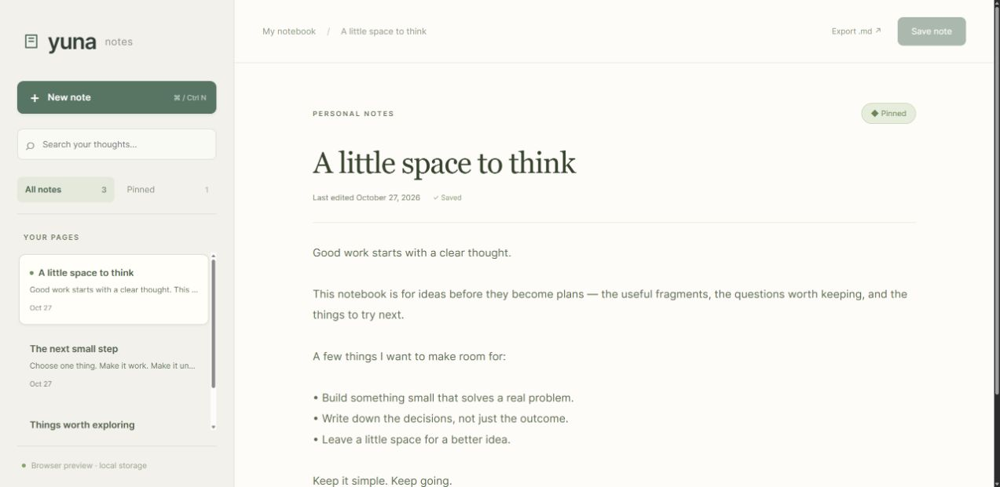

# Yuna Notes

**A little space to think.**

A local-first notebook built with **Tauri 2, Rust, SQLite, React, and TypeScript**. Keep plain-text and Markdown notes, pin the ones you return to, and find an idea without sending it to a server.



## Run the desktop app

Install **Node.js 24+**, npm, Rust, and the [Tauri system prerequisites](https://v2.tauri.app/start/prerequisites/) for your platform. Windows needs the Microsoft C++ build tools and WebView2 runtime.

```sh
npm ci
npm run tauri -- dev
```

To compile a Windows application without packaging an installer:

```sh
npm run tauri -- build --debug --no-bundle
```

The executable is `src-tauri/target/debug/yuna-notes.exe`. `npm run tauri -- build` creates an unsigned Windows NSIS installer. The configured bundle target is Windows; packaging on other platforms needs the appropriate Tauri target configuration. No signed releases are supplied by this repository.

## Browser preview

```sh
npm run dev
```

Open **http://127.0.0.1:4320**. Browser mode is clearly labeled and stores notes in that browser's local storage. It is a working preview with its own data, **separate from the desktop SQLite notebook**. Clearing browser data removes preview notes. The screenshot shows example notes created through the interface.

## What works

- Create, edit, save, and delete notes.
- Search titles and contents; filter pinned notes.
- Keep pinned notes above recent notes.
- Save using the button or **Ctrl/Cmd+S**; create with **Ctrl/Cmd+N** where the host allows that shortcut.
- See unsaved changes and confirm before switching away from edited text.
- Export the current editor text as a Markdown file.
- Keep the current text visible when validation, storage, or stale-version checks fail.
- Use a responsive layout with a horizontal note picker on narrow screens.

## Storage and boundaries

```text
Desktop: React → typed Tauri commands → Rust store → local SQLite
Preview: React → same repository interface → browser local storage
```

Desktop commands expose only `list_notes`, `create_note`, `save_note`, and `delete_note`. The database path comes from Tauri's application-data directory, rather than a path supplied by the frontend. No filesystem, shell, network, telemetry, or cloud-sync plugin is installed. The window uses a content security policy.

Rust validates note lengths and uses bound SQL parameters. Versioned updates and deletes reject stale records. The browser adapter also validates its saved schema, reports quota/corruption errors, and leaves unreadable stored data unchanged. Neither storage mode is encrypted; device-level access remains the security boundary.

The desktop database is `notes.sqlite` inside the application's data directory for `dev.rostha.yunanotes`. Back up that directory while the app is closed, or export individual notes as Markdown. There is no import, synchronization, or rich-text rendering feature in this demo. Markdown remains editable text.

## Code map

| Path                     | Responsibility                                                |
| ------------------------ | ------------------------------------------------------------- |
| `src/App.tsx`            | Notebook interface, dirty state, shortcuts and error handling |
| `src/storage.ts`         | Shared repository contract and browser/native adapters        |
| `src/types.ts`           | Note model, ordering and input validation                     |
| `src-tauri/src/lib.rs`   | Four native commands and application-data setup               |
| `src-tauri/src/store.rs` | SQLite operations and Rust regression tests                   |
| `tests/storage.test.ts`  | Browser-storage persistence and failure cases                 |

## Verify

```sh
npm test
npm run build
npm run test:rust
```

JavaScript tests cover CRUD persistence, stale edits and deletes, corrupted data, quota failures, input limits, and pinned ordering. Rust tests use temporary SQLite databases to check persistence across reopening, stale-write rejection, input validation, and bound parameters. CI runs the frontend checks, Rust tests and formatting, and a Windows desktop compilation.

## Scope

Created as a public portfolio demo in October 2026. This is a new, self-contained implementation, separate from private projects. The mark and interface are original; the open-source libraries keep their respective licenses. Windows compilation and the browser preview are verified locally; other operating systems and installer distribution are not verified.

Licensed under [Apache 2.0](LICENSE).
